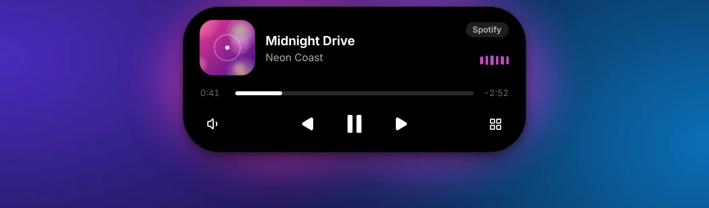
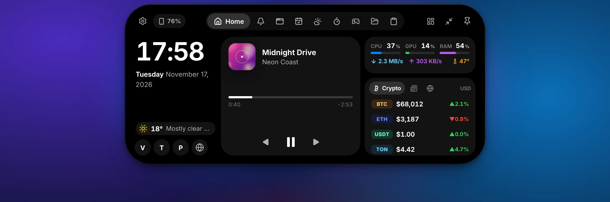
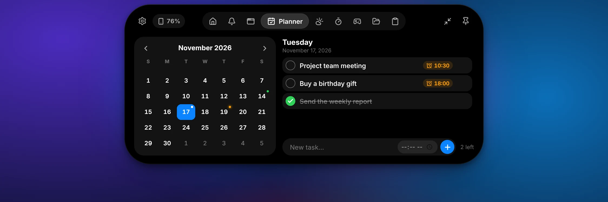
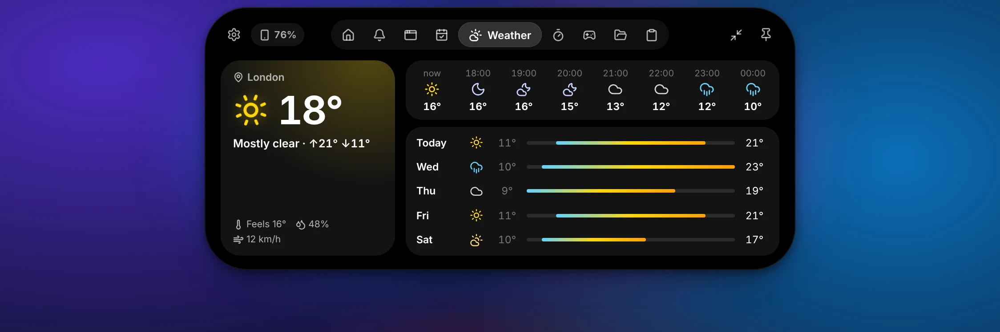
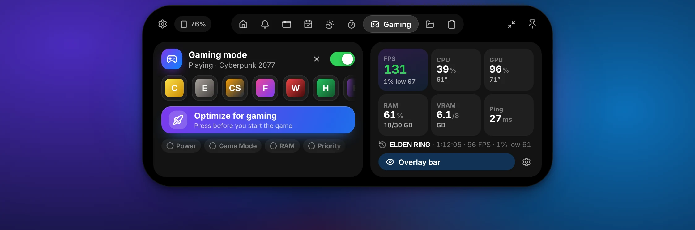
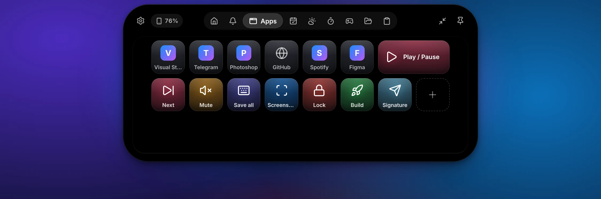
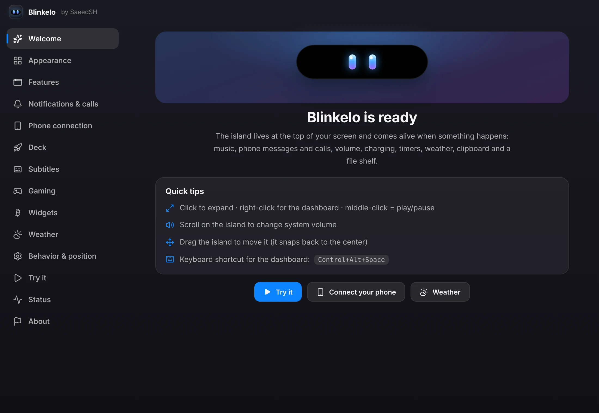
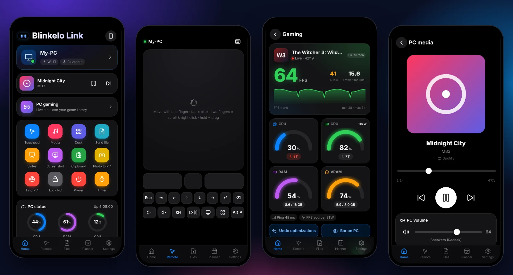

<p align="center">
  
</p>

<h1 align="center">Blinkelo</h1>

<p align="center">
  <b>A Dynamic Island–style notch for Windows that tells you what's happening — with a blink.</b><br>
  Music, phone calls and messages, timers, weather, widgets, subtitles and live gaming stats, right at the top of your screen.<br>
  Comes with <b>Blinkelo Link</b>, an Android companion that turns your phone into a remote for your PC.
</p>

<p align="center">
  <a href="https://github.com/saeedsh70/Blinkelo/releases/latest"></a>
  <a href="https://github.com/saeedsh70/Blinkelo/releases"></a>
  
  
  <a href="LICENSE"></a>
</p>

<p align="center">
  <a href="https://github.com/saeedsh70/Blinkelo/releases/latest"><b>⬇️ Download for Windows</b></a> ·
  <a href="https://github.com/saeedsh70/Blinkelo/releases/latest"><b>📱 Get the Android app</b></a> ·
  <a href="#-support-blinkelo"><b>💜 Support the project</b></a>
</p>

<p align="center">
  
</p>

<p align="center"><sub>▶️ <a href="docs/media/demo.mp4">Watch the demo in full HD (MP4)</a></sub></p>

---

## Why Blinkelo?

Windows has toasts, a tray and a dozen small pop-ups that all look different. Blinkelo replaces them with **one living island** at the top of the screen. It stays a tiny black pill until something happens, then morphs with spring physics to show exactly what you need — and blinks at you so you notice.

- 😉 **It has a personality.** Blinkelo opens its eyes when Windows starts, blinks for every new event and (if you like) peeks around while idle.
- 🎵 **Built for music.** Real audio visualizer, cover art glow, seek bar, and it works with Spotify, YouTube in any browser, VLC, PotPlayer, MPC-HC, mpv and even your phone.
- 📱 **Your phone, on your PC.** Notifications with quick reply, incoming calls, phone music and battery — over Wi-Fi *or Bluetooth*, no Microsoft account needed.
- 🎮 **Gamer friendly.** One-click optimizer, an in-game overlay with FPS, 1% lows, temperatures and VRAM, plus a summary card when you quit.
- 🔒 **Private by design.** No account, no ads, no telemetry. It only goes online for the features you turn on (weather, crypto prices, RSS, subtitle search).
- 🆓 **Free and open source** under the MIT license.

## A quick tour

| | |
|:---:|:---:|
| <br>**Now playing** — cover, visualizer, seek bar, controls | <br>**Incoming calls** from your phone |
| <br>**Messages** from WhatsApp, Telegram, SMS… with quick reply | <br>**Game summary** when you quit a game |
| <br>**Subtitles** found automatically — drag them onto your player | <br>**Files and photos** sent from the phone |
| <br>**Secure pairing** with a verification code | <br><br>**Live activities** — music, timers, stopwatch, two at once |

### The dashboard

Click the island (or press <kbd>Ctrl</kbd>+<kbd>Alt</kbd>+<kbd>Space</kbd>) to open a full dashboard.

| | |
|:---:|:---:|
| <br>**Home** — clock, weather, player, system monitor, crypto, news and world clocks | <br>**Planner** — tasks and reminders, synced with your phone |
| <br>**Weather** — hourly and 5-day forecast (Open-Meteo, no API key) | <br>**Gaming mode** — optimizer, live stats and your game library |

<p align="center"><br><b>Apps &amp; actions</b> — launch apps, files, websites and media actions</p>

<p align="center"><br><b>Settings</b> — every feature can be switched on or off, plus a <i>Try it</i> page to preview each animation</p>

## 📱 Blinkelo Link for Android

<p align="center"></p>

The companion app speaks the open **KDE Connect** protocol (so it also works with KDE Connect on Linux) and adds a lot on top:

- **Touchpad and keyboard** for your PC, presentation mode with the volume keys, power commands (lock, sleep, shut down…)
- **PC media** controls with a lock-screen notification, **PC gaming stats** live on your phone
- **Shared planner and timers**, **Find my PC**, shared clipboard (text *and* images), **Photo to PC**
- Works over **Wi-Fi or Bluetooth**, with authenticated, encrypted links
- No third-party libraries, no ads, Android 8.0+

## ⬇️ Install

### Windows

1. Download **`Blinkelo-x.y.z-win-x64.zip`** from the [latest release](https://github.com/saeedsh70/Blinkelo/releases/latest).
2. Unzip it to the folder where you want to keep it (for example `C:\Apps\Blinkelo`), then run **`Blinkelo.exe`**.
3. Windows SmartScreen may say *"Windows protected your PC"* because the app isn't code-signed yet. Click **More info → Run anyway**. You can check the download against `SHA256SUMS.txt` in the release.
4. If Windows asks about network access, click **Allow** — the phone connection needs it.

No installer, no admin rights. Use the tray icon → **Try it** to see every animation without a phone.

### Android

Download **`BlinkeloLink-x.y.z.apk`** from the [latest release](https://github.com/saeedsh70/Blinkelo/releases/latest), open it on your phone and allow installing from your browser. Then put the phone and the PC on the same Wi-Fi, open Blinkelo Link and tap your PC to pair. Full guide: [`android/README.md`](android/README.md).

## 🖱️ Controls

| Action | What it does |
|---|---|
| **Click** | Open the current activity or the dashboard |
| **Right-click** | Dashboard (decline an incoming call) |
| **Middle-click** | Play / pause |
| **Scroll** | System volume |
| **Drag** | Move the island along the top edge |
| <kbd>Ctrl</kbd>+<kbd>Alt</kbd>+<kbd>Space</kbd> | Toggle the dashboard |
| <kbd>Ctrl</kbd>+<kbd>Shift</kbd>+<kbd>G</kbd> | Show / hide the gaming overlay |

<details>
<summary><b>Full feature list</b></summary>

- 🎵 Now playing from Spotify, browsers, Windows media controls, VLC, PotPlayer, MPC-HC/BE, KMPlayer, GOM, mpv, Winamp and your phone
- 📊 Visualizer driven by the real system audio, coloured from the cover art, with a breathing glow
- 👀 Blink animations: hello at start, a blink for every new event, optional idle peeks
- 📱 Phone notifications with icons, actions and quick reply (Blinkelo Link, KDE Connect or Phone Link)
- 📞 Incoming calls with contact photo; answer/decline through Phone Link, silence the ringer through Blinkelo Link
- 🔔 Windows notifications (Telegram Desktop, WhatsApp, Outlook…) with a queue and history
- 🔊 Volume HUD, 🔋 charger and low battery, ⇪ Caps Lock / Num Lock, 🎙️ microphone and camera privacy dot
- 📋 Clipboard confirmation and history (text and images; password-manager copies are hidden)
- ⏱️ Timer and stopwatch, shared with the phone; two live activities at once with a gooey split
- 🗂️ File shelf: drop files on the island, drag them out later or send them to the phone
- 🧩 Widgets: crypto prices (CoinGecko), RSS news, world clocks · ⛅ weather (Open-Meteo)
- 📅 Planner with reminders, synced with the phone · 🚀 app, file and website shortcuts
- 💬 Subtitle finder for desktop video players (SubDL, OpenSubtitles, Podnapisi), converted to UTF-8
- 🎮 Gaming mode: optimizer, overlay bar with FPS, 1% low, frame time, CPU/GPU usage and temperature, VRAM, RAM, ping; automatic game detection, game library and session summaries
- 🎬 Hides over fullscreen games and videos (except calls) · 🌙 respects Focus / Do Not Disturb
- 🌍 English, العربية, Türkçe, Español, Русский, 简体中文 (with right-to-left support)

</details>

## 🛠️ Build from source

| Folder | What's inside |
|---|---|
| [`windows/`](windows) | **Blinkelo for Windows** — Electron 45 + a native Windows helper (PowerShell/C#) |
| [`android/`](android) | **Blinkelo Link** — Android app (Java, Android SDK only) |

```powershell
# Windows (Node.js 20+)
cd windows
npm install
npm run dev
```

Android: open the `android` folder in Android Studio (Gradle on JDK 17 or 21) and press **Run**, or run `./gradlew assembleDebug`. Details, pairing help and troubleshooting are in [`windows/README.md`](windows/README.md) and [`android/README.md`](android/README.md).

## 🤝 Contributing

Bug reports, ideas and pull requests are welcome. Please open an [issue](https://github.com/saeedsh70/Blinkelo/issues) first for bigger changes. Translations are especially appreciated — all UI strings live in [`windows/src/shared/strings.js`](windows/src/shared/strings.js) and [`android/ui/src/strings.js`](android/ui/src/strings.js).

If you like Blinkelo, **a ⭐ on GitHub helps a lot** — it's how other people find the project.

## 💜 Support Blinkelo

Blinkelo is free, has no ads and collects no data. It's built and maintained by one developer in their spare time. If it makes your desktop a little nicer, a crypto donation of any size keeps the updates coming. Thank you!

| Coin | Network | Address |
|---|---|---|
| **Bitcoin** (BTC) | Bitcoin | `bc1q3znvehkglqfm2pcj8n40ndw0epgkdtmmj8l530` |
| **Tether** (USDT) | TRON (TRC20) | `TVHhgzXfT7sRxrJgJUL3GTuE1cy6ih2X8V` |
| **Tether** (USDT) | BNB Smart Chain (BEP20) | `0x0fAe585Bf585d2d58F086F7D4f3A09ce0441eC8d` |
| **Solana** (SOL) | Solana | `bMB2CMzcfu7yyHJrqgZD8o9eUKii3g76V5zJ1xSUUwv` |

➡️ QR codes and details: **[DONATE.md](DONATE.md)**. Please send each coin **only on the network listed** next to it.

## License

[MIT](LICENSE) © 2026 SaeedSH

<sub>Blinkelo is an independent project and is not affiliated with Apple, Microsoft or KDE. "Dynamic Island" is a trademark of Apple Inc., used here only to describe the style of the app.</sub>
